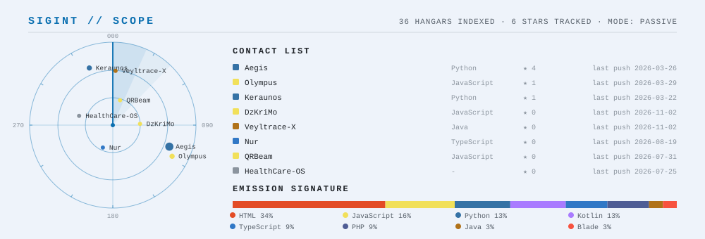
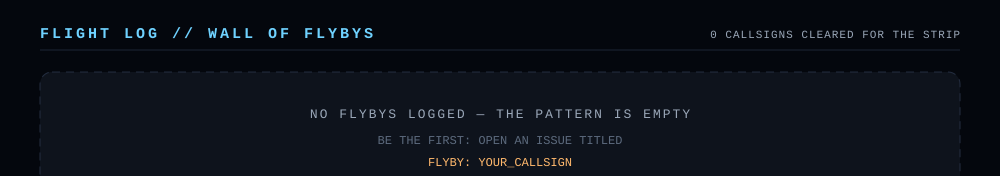

<p align="center">
  <picture>
    <source media="(prefers-color-scheme: dark)" srcset="assets/dark/airspace.svg">
    
  </picture>
</p>

<h3 align="center">Akram Mehdi Amamra · <code>TH3KR1M0</code></h3>
<p align="center"><b>Drive. Code. Secure.</b> — CS Engineer · Security × AI · fast things that turn</p>

<p align="center">
  <a href="https://akrammehdiamamra.online"></a>
  <a href="https://porsche.akrammehdiamamra.online/"></a>
  <a href="https://github.com/DzKriMo?tab=followers"></a>
  
</p>

---

<p align="center">
  <picture>
    <source media="(prefers-color-scheme: dark)" srcset="assets/dark/radar.svg">
    
  </picture>
</p>

<p align="center">
  
</p>

<details>
<summary><b>How the base works</b></summary>
<br>

Everything on this page is **redrawn nightly from live GitHub data** — no servers, no frameworks, only SVGs, SMIL and a scheduled GitHub Action.

- **The Strip** — the contribution graph *is the runway*: 53 weeks × 7 days of light segments, one lit per day you committed. The jet's livery stripes take your top 3 languages' colors, its contrail grows with last week's activity, and the afterburner lights while you're on a streak. The patrol car's pace follows the last six months.
- **SIGINT scope** — every public repo is a contact: position hashed from the repo name, size by stars, color by language. The sweep never stops.
- **ARIA deck log** — the onboard AI types a recon report built from the snapshot: `data/snapshot.json`.
- **Flight log** — see below. Visitors fly, the tower clears them.

The pipeline: `scripts/fetch.mjs` collects a snapshot (GraphQL in CI, public endpoints locally) → `scripts/render.mjs` paints `assets/` for both color schemes → the Action commits the result. Sources in [`scripts/`](scripts/).

</details>

---

## Flight Log

<p align="center">
  
</p>

<p align="center">
  <a href="https://github.com/DzKriMo/DzKriMo/issues/new?title=FLYBY%3A%20YOUR_CALLSIGN&body=Requesting%20a%20flyby%20over%20THE%20STRIP.%0A%0A-%20Replace%20%60YOUR_CALLSIGN%60%20in%20the%20title%20with%20anything%20(keep%20it%20clean%2C%20the%20tower%20is%20listening).%0A-%20Hit%20%2A%2ACreate%2A%2A%20%E2%80%94%20the%20tower%20clears%20you%20in%20under%20a%20minute%20and%20paints%20you%20on%20the%20wall.">
    
  </a>
</p>

<p align="center"><sub>Opens a pre-filled issue. The tower bot clears your callsign, closes the issue and repaints the wall.</sub></p>

---

## Telemetry

<p align="center">
  <a href="https://github.com/DzKriMo">
    
  </a>
  <a href="https://github.com/DzKriMo">
    
  </a>
  <br>
  <a href="https://github.com/DzKriMo">
    
  </a>
  <a href="https://github.com/DzKriMo">
    
  </a>
</p>

---

## Hangars — featured builds

| Project | What it is |
| --- | --- |
| [**Aegis**](https://github.com/DzKriMo/Aegis) | AI Agents Guardrail — security layers for agentic systems |
| [**SENTINEL**](https://github.com/DzKriMo/SENTINEL) | Multi-Standard Downgrade Attack Detection System |
| [**Keraunos**](https://github.com/DzKriMo/Keraunos) | Autonomous penetration-testing orchestrator |
| [**Olympus**](https://github.com/DzKriMo/Olympus) | Intentionally vulnerable webapp for testing pentest agents |
| [**GT3RS-Lab**](https://github.com/DzKriMo/GT3RS-Lab-Backend) | Porsche fanboy full-stack playground — *"what did you expect"* |
| [**ECG-Bench**](https://github.com/DzKriMo/ECG-Bench) | ML benchmark work on ECG data |

---

## Flight clearance

**Security** — offensive & defensive · threat detection · anomaly analysis
**AI/ML** — PyTorch · TensorFlow · OpenCV · LLM agents & guardrails
**Infra** — Docker · Linux · Git · ArgoCD · nginx · secure pipelines
**Languages** — Python · TypeScript · JavaScript · PHP · Kotlin · Go · Java

```text
Precision > Complexity
Security > Convenience
Observability > Assumptions
Performance > Buzzwords
```

> *"I treat infrastructure like engines: measure → tune → stress → harden."*
> — great security feels invisible, like a perfectly tuned drivetrain

---

<p align="center"><sub>Every panel above is regenerated from live GitHub data — the strip never shows the same night twice.</sub></p>
<p align="center"><sub><b>DZ-KRI FLIGHT OPS</b> · no servers · no frameworks · just SVG + SMIL + <a href="https://github.com/DzKriMo/DzKriMo/actions">one scheduled Action</a></sub></p>
