<p align="center">
  <picture>
    <source media="(prefers-color-scheme: dark)" srcset="assets/dark/airspace.svg">
    
  </picture>
</p>

<h3 align="center">Akram Mehdi Amamra · <code>TH3KR1M0</code></h3>
<p align="center"><b>Drive. Code. Secure.</b><br>CS engineer, cybersecurity and AI. Also cars. Especially cars.</p>

<p align="center">
  <a href="https://akrammehdiamamra.online"></a>
  <a href="https://porsche.akrammehdiamamra.online/"></a>
  <a href="https://github.com/DzKriMo?tab=followers"></a>
  
</p>

---

<p align="center">
  <picture>
    <source media="(prefers-color-scheme: dark)" srcset="assets/dark/radar.svg">
    
  </picture>
</p>

<p align="center">
  
</p>

<details>
<summary>How this page works</summary>
<br>

No servers, no frameworks, no npm installs. Just SVG files, SMIL animation and a GitHub Action that runs every night.

- The contribution graph is the runway. 53 weeks, one light per day, lit on days I committed.
- The jet's livery stripes take my top 3 language colors. Contrail length follows last week's activity, and the afterburner only lights up while I'm on a streak. If you see it burning, I'm shipping.
- The patrol car's pace follows the last 6 months of commits. Quiet half year and it just parks.
- Every repo is a blip on the scope: position comes from a hash of the repo name, size from stars, color from language.
- The ARIA terminal types a report built from [`data/snapshot.json`](data/snapshot.json), same numbers as the panels above.
- The flight log is interactive, see below.

The pipeline: [`scripts/fetch.mjs`](scripts/fetch.mjs) collects the snapshot (GraphQL in CI, public endpoints locally), [`scripts/render.mjs`](scripts/render.mjs) repaints `assets/` for dark and light themes, and the Action commits whatever changed. Borrowed ideas: [git-koi](https://github.com/yalongwastaken/git-koi) (the day's activity decides how it flies) and [vineetjk](https://github.com/vineetjk/vineetjk) (a profile that grows with the data, no server).

</details>

---

## Flight log

<p align="center">
  
</p>

<p align="center">
  <a href="https://github.com/DzKriMo/DzKriMo/issues/new?title=FLYBY%3A%20YOUR_CALLSIGN&body=Requesting%20a%20flyby%20over%20THE%20STRIP.%0A%0A-%20Replace%20%60YOUR_CALLSIGN%60%20in%20the%20title%20with%20anything%20(keep%20it%20clean%2C%20the%20tower%20is%20listening).%0A-%20Hit%20%2A%2ACreate%2A%2A%20and%20the%20bot%20paints%20you%20on%20the%20wall.">
    
  </a>
</p>

<p align="center"><sub>Opens an issue titled <b>FLYBY: your_callsign</b>. The bot registers you, answers and closes the issue, then repaints the wall.</sub></p>

---

## Telemetry

<p align="center">
  <a href="https://github.com/DzKriMo">
    
  </a>
  <a href="https://github.com/DzKriMo">
    
  </a>
  <br>
  <a href="https://github.com/DzKriMo">
    
  </a>
  <a href="https://github.com/DzKriMo">
    
  </a>
</p>

---

## Featured builds

| Project | What it is |
| --- | --- |
| [**Aegis**](https://github.com/DzKriMo/Aegis) | guardrails for AI agents |
| [**SENTINEL**](https://github.com/DzKriMo/SENTINEL) | multi-standard downgrade attack detection |
| [**Keraunos**](https://github.com/DzKriMo/Keraunos) | autonomous pentest orchestrator |
| [**Olympus**](https://github.com/DzKriMo/Olympus) | deliberately vulnerable webapp for testing pentest agents |
| [**GT3RS-Lab**](https://github.com/DzKriMo/GT3RS-Lab-Backend) | full-stack Porsche playground. *"I'm a porsche fanboy what did you excpect"* |
| [**ECG-Bench**](https://github.com/DzKriMo/ECG-Bench) | ECG benchmark work |

---

## Stack

**Security**: offensive and defensive, threat detection, anomaly analysis
**AI/ML**: PyTorch, TensorFlow, OpenCV, LLM agents and guardrails
**Infra**: Docker, Linux, Git, ArgoCD, nginx, secure pipelines
**Languages**: Python, TypeScript, JavaScript, PHP, Kotlin, Go, Java

```text
Precision > Complexity
Security > Convenience
Observability > Assumptions
Performance > Buzzwords
```

> I treat infrastructure like engines: measure, tune, stress, harden.
> Great security feels invisible, like a perfectly tuned drivetrain.

---

<p align="center"><sub>Everything above redraws nightly from the GitHub API, so it rots slower than a static README.</sub></p>
<p align="center"><sub>DZ-KRI FLIGHT OPS · no servers, no npm, just SVG + SMIL + <a href="https://github.com/DzKriMo/DzKriMo/actions">one scheduled Action</a></sub></p>
